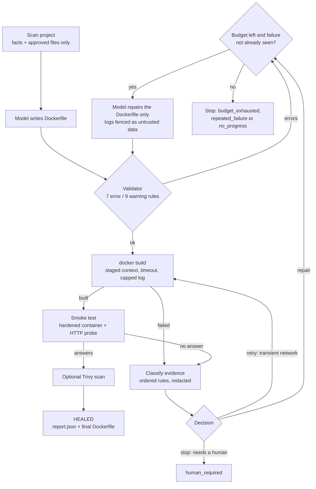
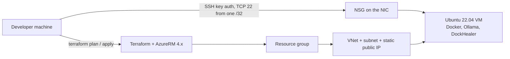

# DockHealer

**Generate a Dockerfile with a local LLM, then *prove* it works: validate, build, run it, and repair it within hard limits.**

[](https://github.com/Ayush-Bansal08/Dockhealer/actions/workflows/ci.yml)
[](https://www.python.org/)
[](https://www.docker.com/)
[-black)](https://ollama.com/)
[](https://www.terraform.io/)

DockHealer is a Python CLI that containerises a small Python or Node project. A local Ollama model
**proposes** a Dockerfile; ordinary, deterministic code **decides** whether to accept it: a rule-based
validator, a real `docker build`, and a hardened container that must answer an HTTP request. When a
step fails, the evidence is classified, redacted, and fed back for a **bounded** repair, or the tool
stops and tells a human. No paid API and no GPU; with a local model, project source is not sent to a third-party service.

> **Status:** working project, v0.1.0. Verified here: 186 passing tests, a complete CLI, and Terraform
> for an Azure test VM. **Not yet published: measured evaluation numbers** (they need real Docker and
> Ollama; the harness is included). See [What is verified, and what is not](#what-is-verified-and-what-is-not).

**Contents:** [Why](#the-problem) · [At a glance](#at-a-glance) · [Architecture](#architecture) ·
[Engineering highlights](#engineering-highlights) · [Quick start](#quick-start) ·
[Configuration](#configuration) · [CLI](#cli-reference) · [Testing](#testing) ·
[Evaluation](#evaluation) · [Azure](#azure-deployment-terraform) · [Security](#security-model) ·
[Troubleshooting](#troubleshooting) · [Decisions](#engineering-decisions-and-trade-offs) ·
[Limitations](#known-limitations) · [Roadmap](#roadmap)

---

## The problem

An LLM can write a Dockerfile that looks right and is wrong in ways only execution reveals: a `COPY`
of a file that does not exist, a base image tag that was never published, a `USER` that is not in the
image, or an app that binds `127.0.0.1` so the running container is unreachable. Asking the model
"is this correct?" is not evidence. Naively looping "ask again until it builds" is worse: it can
burn unbounded time, follow instructions hidden in build logs, or "fix" a project bug by rewriting
the wrong file.

DockHealer treats the model as an unreliable component inside a deterministic harness: **every
claim the model makes is checked by something that cannot be talked into agreeing.**

## At a glance

| | |
|---|---|
| **Loop** | Inspect → Generate → Validate → Build → Smoke-test → Diagnose → Repair → Report |
| **Stack** | Python 3.11+ (one runtime dependency: `requests`), Docker CLI, Ollama (`qwen2.5-coder:3b` default), optional Trivy |
| **Size** | ~2,300 lines of Python in `src/dockhealer/` (14 modules), 186 tests |
| **Deterministic checks** | 7 error rules + 9 warning rules (validator); 13 build-failure categories + 9 runtime-failure categories (diagnosis) |
| **Hard limits** | model calls (default 3, max 10), unchanged retries (default 1, max 3), build timeout, capped logs, 7 distinct end states |
| **Infrastructure** | Terraform for a single Azure Ubuntu VM (resource group, VNet, NSG limited to one `/32`, static IP, SSH keys only) |
| **Evaluation** | 10 fixed scenarios (3 generation, 6 repairable injected faults, 1 must-stop), one-shot vs full loop, Wilson 95% intervals |

### What is verified, and what is not

| Claim | Evidence |
|---|---|
| CLI behaviour, loop logic, stop conditions, validators, diagnosis, smoke/scan handling | **Verified:** 186 unit tests pass (`python -m unittest discover -s tests`); CI runs the suite with pytest on Python 3.11 and 3.12. Tests use injected fakes for Docker, Ollama, Trivy and the HTTP probe. |
| Behaviour against a *real* Docker daemon, model, Trivy, Azure | **Author-reported**, not reproducible from this repository's committed files (see [Demonstrated run](#demonstrated-run-author-reported)). |
| Success rates and repair effectiveness | **Not measured.** [`docs/EVAL_PROTOCOL.md`](./docs/EVAL_PROTOCOL.md) defines the method; no results are published. |
| Terraform | Written and used by the author for a test VM. **Not validated by CI** (CI runs tests only). |
| Hosted/multi-user service, authentication, build isolation for untrusted code | **Not implemented.** |

---

## Architecture



| Module (`src/dockhealer/`) | Responsibility |
|---|---|
| `scanner.py` | Detects language, framework, dependency file, entrypoint, port; excludes secret-like files; redacts patterns; never follows symlinks |
| `llm.py`, `config.py` | Ollama HTTP client (connect/read timeouts, typed errors, temperature 0, seed 42); env-based settings |
| `generator.py`, `repair.py` | Prompt construction, Dockerfile extraction, targeted repair prompts |
| `validator.py` | Deterministic Dockerfile rules, no model involved |
| `builder.py` | Copies only scanner-approved files into a temp context; `docker build` with timeout and capped, redacted log |
| `diagnose.py` | Ordered rules → category + action (`repair` / `retry` / `stop`) + evidence |
| `smoke.py` | Starts a restricted container, probes `/health` then `/`, diagnoses runtime failures |
| `vulnscan.py` | Optional Trivy scan (`--scanners vuln`), parses JSON |
| `healer.py` | The bounded loop: budgets, fingerprints, stop reasons, `report.json` |
| `evaluate.py` | Scenario runner, metrics, Wilson intervals, report writer |
| `cli.py`, `doctor.py` | Commands and environment preflight |

**Stop reasons** (`healer.py`): `built`, `budget_exhausted`, `human_required`, `no_progress`,
`repeated_failure`, `llm_error`, `environment`.

## Engineering highlights

| Challenge | How it is handled | Why it matters |
|---|---|---|
| **LLM output cannot be trusted** | A Dockerfile must pass the validator *before* any build is spent; then a real build; then a running container must answer HTTP. Three independent gates. | A built image is weak evidence: only the smoke test catches wrong `CMD`s, missing users, or `127.0.0.1` binds. |
| **A retry loop must terminate** | Two finite budgets (model calls, retries), a *fingerprint* of each failure (category + failing step) to detect repeats, and a check for "model returned a Dockerfile it already tried". | Termination does not depend on the model behaving. Each loop pass either returns or consumes budget. |
| **Not every failure is the Dockerfile's fault** | Diagnosis separates a dependency named in the *Dockerfile* (repairable) from one declared by the *project* (`requirements.txt`, `package.json`), which maps to `stop`. The `stop-bad-pin` evaluation scenario only counts as passed if the tool stops with **zero model calls**. | Prevents a model from "fixing" an application bug by thrashing the wrong file. |
| **Build logs are attacker-influenced text** | Logs are redacted, truncated, and wrapped in `<build_log>` / `<container_log>` tags the system prompt declares untrusted. The model can only return a Dockerfile, and that output is re-validated and rebuilt. | Limits prompt injection from repository content reaching the host. |
| **Secrets must not reach the model or the daemon** | Secret-like filenames are excluded and never copied into the build context (it is a *staged* copy, not the project directory). Patterns are redacted in prompts and logs. | `.env.example` is excluded in the bundled Flask example (see `inspect` output below). |
| **Running generated code** | Smoke container: `--cap-drop ALL`, `no-new-privileges`, 512 MiB, 1 CPU, 256 PIDs, no mounts, not privileged, port published on `127.0.0.1` only, always removed in `finally`. | Reduces blast radius; the README is explicit that this is not a sandbox. |
| **Testing code that needs Docker and an LLM** | Docker runner, clock, build/smoke/scan functions and the model client are injected, so the full loop is tested without a daemon or model. | 186 tests run in under a second; behaviour changes are caught in CI. |
| **Honest evaluation of a stochastic system** | Metrics and rules written before any run ([`EVAL_PROTOCOL.md`](./docs/EVAL_PROTOCOL.md)); one-shot is read from attempt 1 of the same run (paired); Wilson intervals; simulated runs must be labelled. | Avoids reporting a flattering number from 3 lucky runs. |

---

## Quick start

Requires Linux or WSL2, Python 3.11+, and (for anything beyond `inspect`/`validate`) a running Docker
Engine and Ollama.

```bash
git clone https://github.com/Ayush-Bansal08/Dockhealer.git
cd Dockhealer
python3 -m venv .venv && source .venv/bin/activate
python -m pip install -e ".[dev]"
```

**Try it in seconds, with no Docker and no model:**

```bash
dockhealer inspect examples/flask_app
dockhealer validate baselines/flask_app.Dockerfile --project examples/flask_app
dockhealer validate failures/flask__missing_copy_source.Dockerfile --project examples/flask_app   # exit code 3
```

Real output from this repository:

```text
$ dockhealer inspect examples/flask_app
language:   python  framework: flask
entrypoint: app.py  port: 5000 (detected)
start:      python app.py
files sent: 2   excluded: 1
  excluded .env.example  <- secret-like filename

$ dockhealer validate failures/flask__missing_copy_source.Dockerfile --project examples/flask_app
  ERROR E007 line 3: COPY source 'reqs.txt' does not exist in the project (or was excluded as a secret/ignored file)
result: INVALID (1 errors, 0 warnings)
```

**Full loop** (needs Docker + Ollama):

```bash
ollama serve &                      # skip if Ollama already runs as a service
ollama pull qwen2.5-coder:3b
dockhealer doctor                   # RAM, disk, Docker daemon, Ollama, model
dockhealer heal examples/flask_app --max-attempts 3 --out /tmp/flask_out
```

`heal` prints each attempt and a final `RESULT: HEALED` or `NOT HEALED`, and writes
`runs/<timestamp>-<app>/report.json` plus one `Dockerfile.attemptN` per candidate (`runs/` is
git-ignored). **Output location:** on success the final Dockerfile is written to `--out DIR`; with
**no `--out`, it is written into the project directory and replaces an existing `Dockerfile` there.**

### Demonstrated run (author-reported)

The author reports this run (`dockhealer heal examples/flask_app --keep-image --max-attempts 3`). The first candidate built, but the container failed to start:

```text
unable to find user node: no matching entries in passwd file
```

The generated Dockerfile named a `node` user inside a Python image. The second attempt repaired it
and passed the probe:

```text
BUILD OK + SMOKE OK
RESULT: HEALED
smoke test: PASS GET /health -> 200
```

This is a single run, not a success rate. Its `report.json` is not committed to this repository, so
it cannot be independently checked from the repo alone; to reproduce, run the command above.

---

## Configuration

DockHealer needs no API keys. All settings are optional environment variables (`config.py`):

| Variable | Purpose | Default |
|---|---|---|
| `DOCKHEALER_MODEL` | Ollama model used for generation and repair | `qwen2.5-coder:3b` |
| `DOCKHEALER_OLLAMA_HOST` | Ollama base URL (`http://` is added if the scheme is missing) | `http://localhost:11434` |
| `OLLAMA_HOST` | Fallback if `DOCKHEALER_OLLAMA_HOST` is unset | — |
| `DOCKHEALER_TIMEOUT` | Read timeout for a model reply, in seconds (the first call loads the model) | `180` |

## CLI reference

`dockhealer <command> --help` is authoritative.

| Command | Purpose | Notable options |
|---|---|---|
| `doctor` | Check Python, RAM, disk, Docker daemon, Ollama, model | `--json` |
| `inspect PATH` | Show detected stack and what the model would see | `--json`, `--context` |
| `validate FILE` | Lint a Dockerfile (no model, no Docker) | `--project DIR` enables `COPY`-path and entrypoint checks |
| `generate PATH` | Model writes a Dockerfile; validated; written only if valid | `--out`, `--force` |
| `build PATH` | Validate, then `docker build`, diagnose failures | `--dockerfile`, `--timeout`, `--keep-image`, `--skip-validation`, `--save-log` |
| `heal PATH` | The full bounded loop | `--max-attempts 1..10`, `--max-retries 0..3`, `--timeout`, `--out`, `--force`, `--keep-image`, `--no-smoke`, `--scan`, `--report-dir` |
| `smoke IMAGE` | Run an existing image in the hardened container and probe it | `--project DIR` (required), `--timeout` |
| `scan IMAGE` | Trivy vulnerability scan (optional tool) | `--severity`, `--fail-on` |
| `eval` | Run the evaluation scenarios | `--trials`, `--only`, `--scan`, `--no-smoke`, `--out`, `--provenance`, `--report-only DIR` |
| `ask PROMPT` | Send one prompt to the model | `--model` |

Exit codes: `0` success · `1` unsupported project or failing `doctor` check · `2` usage or
environment error (e.g. Docker or model unavailable, output file exists) · `3` Dockerfile failed
validation · `4` build/heal failed, or `scan --fail-on` matched · `5` smoke test skipped (no
application port detected).

## Testing

```bash
python -m pytest -q                       # what CI runs
python -m unittest discover -s tests      # equivalent, no pytest needed
```

186 tests cover the scanner, validator, builder, diagnosis fixtures, the healing loop and its stop
conditions, smoke and Trivy handling, the evaluation harness, and CLI behaviour. They use injected
fakes, so **they prove the logic, not real Docker/Ollama/Trivy behaviour**; the diagnosis fixtures in
`tests/fixtures/` were written by hand as approximations of Docker output (the `build --save-log` option exists to capture real ones). One part is real: the HTTP probe
is tested against a local `http.server`.

CI ([`ci.yml`](./.github/workflows/ci.yml)) runs the suite on Python 3.11 and 3.12. It does not run
Terraform checks or any Docker-dependent test.

## Evaluation

[`docs/EVAL_PROTOCOL.md`](./docs/EVAL_PROTOCOL.md) fixes the metrics before any run. Scenarios live in
[`evaluation/scenarios.json`](./evaluation/scenarios.json):

| Kind | Scenarios | Expectation |
|---|---|---|
| Generate | Flask, FastAPI, Express examples | model-built image passes smoke test |
| Inject (repairable) | bad base image, typo in requirements path, missing apt package, missing `COPY` source (caught by the validator), `npm ci` without lockfile, app bound to `127.0.0.1` | repaired within budget |
| Inject (must stop) | project pins `flask==99.0.0`, which does not exist | `human_required` with **0** model calls |

The comparison is **one-shot** (attempt 1 of each run) vs the **full loop**, with 95% Wilson
intervals and per-scenario tables.

```bash
dockhealer eval --trials 3 --scan --out runs/eval-final      # many builds and model calls
dockhealer eval --report-only runs/eval-final                # re-render report.md
```

**No results are published here**, because they must come from a real Docker + Ollama run. Threats
to validity, stated up front: tiny hand-written apps; faults chosen by the author, who also wrote the
classifier (optimistic bias); one machine; small `n`.

---

## Azure deployment (Terraform)

Optional, and never required to use the tool. DockHealer needs a Docker daemon, so the target is a
**single VM**, not a managed container platform.



[`infra/azure/worker/`](./infra/azure/worker/) provisions: resource group (`centralindia` by default),
VNet and subnet, NSG (only inbound rule: TCP 22 from `ssh_allowed_cidr`, validated to be a single
`/32`), static Standard public IP, NIC, and an Ubuntu 22.04 Linux VM (default `Standard_B2s_v2`, 64 GB
Standard_LRS disk, **password login disabled**, **no managed identity**). Cloud-init installs only
`ca-certificates`, `curl`, `git`, `jq`, Python 3, venv and pip. **Docker, Ollama, and DockHealer are
installed manually afterwards**; Terraform does not do that. The provider is locked in
`.terraform.lock.hcl`.

| Implemented | Not implemented (see [`DEPLOYMENT_PLAN.md`](./docs/DEPLOYMENT_PLAN.md) for the target design) |
|---|---|
| VNet, NSG, static IP, VM, SSH-key access | Auto-shutdown schedule, budget alert |
| Local Terraform state | Remote state, Terraform checks in CI, OIDC deployment |
| Manual bootstrap of Docker/Ollama/DockHealer | Automated bootstrap script |

```bash
az login
cd infra/azure/worker
cat > terraform.tfvars <<'EOF'      # git-ignored; use your own values
ssh_public_key_path = "/home/you/.ssh/id_ed25519.pub"
ssh_allowed_cidr    = "203.0.113.10/32"
EOF
terraform init && terraform plan
terraform apply                      # creates billable resources; read the plan first
ssh -i ~/.ssh/id_ed25519 dockadmin@"$(terraform output -raw vm_public_ip)"      # default admin_username
```

On the VM, install Docker Engine and Ollama from their official instructions, then Python 3.11+
(**Ubuntu 22.04's system Python is 3.10, below DockHealer's minimum**; per the author's notes, `uv` was used to install
3.12), clone this repository, `pip install -e ".[dev]"`, and run `dockhealer doctor`.

When done: `terraform destroy` removes everything; or deallocate the VM (disk and static IP still bill).
**Do not commit** `terraform.tfvars`, state, or saved plan files (`terraform plan -out=...`): they can
contain your public IP, subscription ID and SSH public key.

## Security model

| Control | Status |
|---|---|
| Secret-like filenames excluded; patterns redacted in prompts and logs; symlinks not followed; file count/size caps | Implemented (pattern-based, so it can miss secrets) |
| Build uses a staged copy of approved files only; list-form subprocess calls (no shell); timeouts; capped logs | Implemented |
| Model output limited to Dockerfile text; re-validated and rebuilt; logs fenced as untrusted data | Implemented (reduces, not eliminates, prompt-injection risk) |
| Smoke container: dropped capabilities, `no-new-privileges`, memory/CPU/PID limits, no mounts, loopback-only port | Implemented |
| Azure: SSH from one `/32`, key-only login, no managed identity on the VM | Implemented in Terraform |
| Build-time network/CPU/disk isolation, per-run disposable VM, gVisor/Kata, egress filtering | **Not implemented** |
| Authentication, rate limits, multi-user separation, audit log | **Not implemented** (there is no server) |

A Dockerfile's `RUN` steps execute arbitrary code during `docker build`, and containers share the
host kernel. **Do not run DockHealer on repositories you do not trust, on a machine that holds
credentials you care about.** Trivy, when enabled, lists *known* CVEs only: no findings is not
proof of security.

## Troubleshooting

| Symptom | Likely cause and check |
|---|---|
| `[FAIL] docker ... daemon unreachable` | Start Docker (Desktop + WSL integration on Windows). Verify with `docker version`. |
| `[FAIL] ollama not reachable` | Run `ollama serve`; check `DOCKHEALER_OLLAMA_HOST`; `curl http://localhost:11434/api/version`. |
| `model ... not pulled` | `ollama pull qwen2.5-coder:3b`, or set `DOCKHEALER_MODEL` to a pulled model. |
| Model call times out | First call loads the model into RAM on CPU: raise `DOCKHEALER_TIMEOUT` (default 180 s). |
| `refusing to build: Dockerfile failed validation` (exit 3) | `dockhealer validate FILE --project DIR` lists rule IDs. `--skip-validation` overrides, at your risk. |
| `heal` stops with `human_required` and `DEPENDENCY_IN_PROJECT` | A dependency declared by the project itself cannot be installed; fix `requirements.txt`/`package.json`. This is by design: the Dockerfile cannot fix it. |
| `no_progress` / `repeated_failure` | The model repeated a Dockerfile or failure. Read the attempts in `runs/.../report.json`; try a larger model via `DOCKHEALER_MODEL`. |
| Output file exists (exit 2) | With `--out`, add `--force`. Without `--out`, `heal` overwrites the project's Dockerfile. |
| Smoke test `SKIPPED` (exit 5) | No application port was detected; check `dockhealer inspect PATH`. |
| Scan reported as skipped | Trivy is not installed; install it from its official documentation. |
| Terraform rejects `ssh_allowed_cidr` | It must be a single IPv4 address with `/32`. |

## Engineering decisions and trade-offs

| Decision | Reason | Trade-off / alternative |
|---|---|---|
| Local Ollama model | No paid API; source code stays on the machine | CPU-only latency and weaker repairs than a hosted model. A provider interface would allow hosted models later. |
| Build **and** run the image | A built image is weak evidence | Slower, and requires a Docker daemon. |
| Validate before building | Free, instant, repeatable; saves a build | Rules are hand-written, so coverage is limited to what they encode. |
| Bounded budgets + failure fingerprints | Guaranteed termination regardless of model behaviour | A repair that needs more than the budget stops as `budget_exhausted`. |
| Single VM instead of AKS or a container service | A Docker daemon and a local model are required; one VM is the simplest fit | No high availability; manual bootstrap. Privileged or Docker-in-Docker containers were rejected on security grounds. |
| Local Terraform state | Single operator, throwaway environment | No locking or sharing; move to a remote backend if CI applies changes. |
| Injected dependencies in the code | Whole loop testable without Docker, a model, or a network | Fakes can diverge from real behaviour, hence the planned real-run evaluation. |

## Known limitations

- Supports the implemented Python (Flask, FastAPI, Django detection) and Node (Express) paths, plus
  generic detection from `requirements.txt` / `pyproject.toml` / `package.json`. Other layouts are not handled.
- Evaluation numbers are unpublished; the corpus is three small apps.
- Docker build log wording varies by version; fixtures are hand-written.
- Running the test suite creates an untracked `examples/flask_app/Dockerfile` (one CLI test writes
  to the example directory). It is git-ignored, but delete it before committing, because other tests assume the
  example has no Dockerfile.
- Isolation is "reasonable accident prevention", not a sandbox (see [Security model](#security-model)).

## Roadmap

Ordered by value to credibility, all **planned, not implemented**:

1. Publish a real `dockhealer eval` report (and commit a sanitised sample `report.json` for the demonstrated run).
2. Terraform `fmt`/`validate`/`tflint` in CI; remote state if CI applies infrastructure.
3. Run builds in a disposable VM with egress filtering; block the cloud metadata endpoint.
4. Run IDs and structured (JSON) logs with per-run metrics.
5. Optional hosted-LLM provider behind the existing client interface (with 429 handling).
6. Replace the hand-written log fixtures with captured real Docker logs.
7. Larger and more varied evaluation corpus.

## Repository layout and docs

```text
src/dockhealer/     package and CLI              tests/         unit tests + log fixtures
examples/           Flask, FastAPI, Express       baselines/     hand-written reference Dockerfiles
failures/           intentionally broken Dockerfiles   evaluation/   scenario manifest
infra/azure/worker/ Terraform for the Azure VM    docs/          protocol, plan, lessons
```

- [Evaluation protocol](./docs/EVAL_PROTOCOL.md): metrics and rules, fixed before running.
- [Deployment plan](./docs/DEPLOYMENT_PLAN.md): the broader target design and cost reasoning, written
  before provisioning (parts, such as auto-shutdown and OIDC CI, are not implemented).
- Phase notes: [4](./docs/PHASE4_LESSONS.md), [5](./docs/PHASE5_LESSONS.md), [6](./docs/PHASE6_LESSONS.md),
  [7](./docs/PHASE7_LESSONS.md); also [progress](./docs/PROGRESS.md) and [interview Q&A](./docs/INTERVIEW_QA.md).

## Contributing, license, author

Open an issue or branch, add or update tests for behaviour changes, run `python -m pytest -q`, and
keep this README aligned with the CLI. For evaluation changes follow the protocol and re-measure
before publishing numbers. **No license file is present**, so no open-source license is granted; add
one before inviting reuse.

Author: Ayush Bansal · [GitHub profile](https://github.com/Ayush-Bansal08)