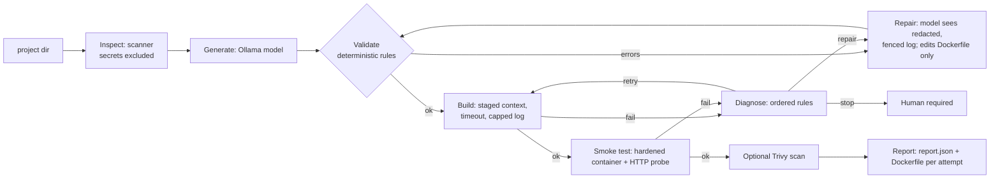

# dockhealer

AI-assisted Dockerfile generation with a **bounded feedback loop**:
`Inspect -> Generate -> Validate -> Build -> Diagnose -> Repair -> Test -> Report`

Runs fully locally (Python + Docker + Ollama, no paid APIs, no GPU). Azure/Terraform deployment is an
optional later phase and is never required for local use.

> Status: **Phase 7 of 8** (… smoke test, vulnerability scan, failure injection + evaluation harness). See `docs/PROGRESS.md`.
> **No evaluation numbers are published yet**: they must be produced on a machine with real Docker + Ollama (`dockhealer eval`). See `docs/EVAL_PROTOCOL.md`.

## Quick start (WSL2 Ubuntu)

```bash
python3 -m venv .venv && source .venv/bin/activate
pip install -e ".[dev]"

# Ollama (skip if installed)
curl -fsSL https://ollama.com/install.sh | sh
ollama serve &                      # or it may already run as a service
ollama pull qwen2.5-coder:3b        # size chosen by `dockhealer doctor` from your RAM

dockhealer doctor                   # preflight: RAM, disk, Docker, Ollama, model
dockhealer ask "Reply with exactly: OK"
dockhealer validate baselines/flask_app.Dockerfile --project examples/flask_app
dockhealer generate examples/flask_app            # model writes it, validator judges it
dockhealer build examples/flask_app --dockerfile baselines/flask_app.Dockerfile   # needs Docker running
dockhealer heal examples/flask_app --out /tmp/flask_out --scan   # full loop + smoke test (+ Trivy if installed)
dockhealer smoke <image> --project examples/flask_app   # run an image and probe it
dockhealer scan <image> --fail-on CRITICAL              # Trivy scan (optional)
dockhealer inspect examples/flask_app --context   # what the model would see
dockhealer eval --trials 3 --scan   # failure injection + evaluation (many builds + model calls; writes runs/eval-*/report.md)
pytest -v                           # or: python -m unittest discover -s tests -v
```

`dockhealer heal` writes the final Dockerfile into the project directory only after the image
build and smoke test succeed. Use `--out DIR` to write the successful result somewhere else.

Configuration (all optional): `DOCKHEALER_MODEL`, `DOCKHEALER_OLLAMA_HOST`, `DOCKHEALER_TIMEOUT`.

## Layout

```
src/dockhealer/
  config.py   settings from env (model, host, timeout, deterministic sampling)
  llm.py      Ollama HTTP client with typed errors and hard timeouts
  doctor.py   preflight checks + model recommendation by RAM
  scanner.py  safe project inspection: stack, port, start command, secret exclusion/redaction
  generator.py prompt + Dockerfile extraction + safe write (never overwrites without --force)
  validator.py deterministic rules E001-E012 (errors) / W001-W009 (warnings), no model involved
  builder.py  staged-context `docker build` with timeout, capped log, injected runner
  diagnose.py ordered rules: build log -> category + repair/retry/stop decision
  repair.py   targeted repair prompt (logs fenced as untrusted data)
  smoke.py    hardened `docker run` + HTTP probe + runtime diagnosis
  vulnscan.py optional Trivy scan, honest about what it does not prove
  healer.py   the bounded loop: budgets, stop reasons, run report
  evaluate.py scenarios, metrics (Wilson CIs), report writer for `dockhealer eval`
  cli.py      `eval`, `heal`, `doctor`, `inspect`, `validate`, `generate`, `build`, `ask`
failures/     Dockerfiles that pass the validator but fail to build (failure-injection inputs)
baselines/    hand-written reference Dockerfiles (evaluation baseline; must validate clean)
examples/     tiny Flask / FastAPI / Express apps (also the evaluation corpus later)
evaluation/   scenarios.json (fixed before running); docs/EVAL_PROTOCOL.md defines metrics
tests/        unit tests (no Ollama or Docker needed)
```

## Architecture


Model proposes; plain code decides. Budgets (model calls, retries) guarantee termination.

## Failure injection and evaluation
`failures/` holds Dockerfiles that break on purpose (bad base image, typo path, missing apt package, missing COPY source, `npm ci` without lockfile, app bound to localhost) plus a project whose own dependency pin cannot resolve (the tool must STOP, not repair). `dockhealer eval` runs these and 3 generation scenarios, comparing one-shot (attempt 1) against the full loop and a hand-written reference. Metrics, rules and threats to validity are in `docs/EVAL_PROTOCOL.md`; the report lists sample sizes and 95% Wilson intervals.

## Known limitations
- Real Docker/Ollama/Trivy behaviour was not available while building; unit tests use fakes. Log fixtures are hand-written approximations until replaced with real captures.
- Corpus is 3 tiny apps; injected faults were written by the tool's author (optimistic bias).
- Smoke test shows "starts and answers HTTP", not correctness. Trivy lists known CVEs only.
- Docker isolation is not a perfect sandbox. Small local models may fail repairs; the tool then stops and says so.
