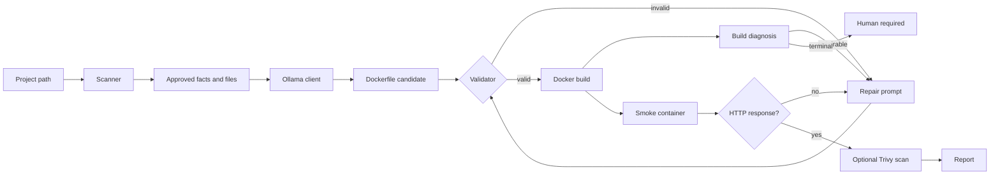
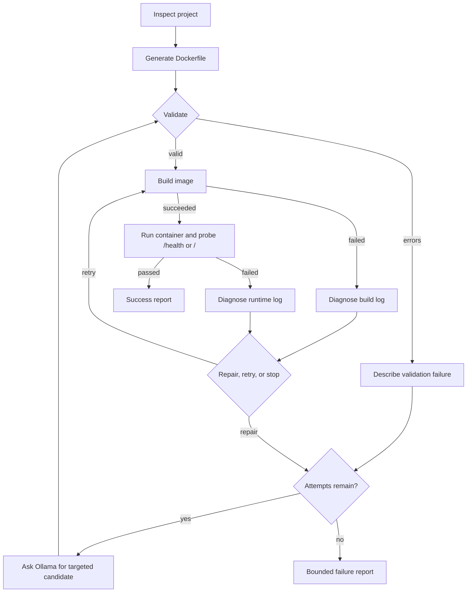
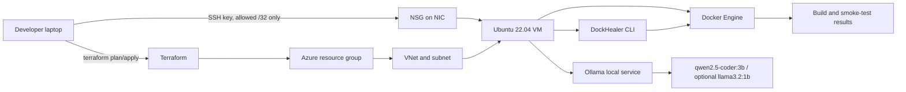

# DockHealer

### Generate a Dockerfile, test it like a real container, and make bounded repair attempts when it fails.

DockHealer is a local Python CLI for turning a small Python or Node project into a Docker image. It
combines deterministic project inspection and Dockerfile validation with a local Ollama model, a real
Docker build, an HTTP smoke test, and a bounded repair loop. The model proposes Dockerfiles; ordinary
code decides whether they are valid, whether Docker can build them, whether the resulting container
answers HTTP, and when the process must stop.

[](https://github.com/Ayush-Bansal08/Dockhealer/actions/workflows/ci.yml)
[](https://www.python.org/)
[](https://www.docker.com/)
[](https://ollama.com/)
[](https://www.terraform.io/)

> **Project status:** active engineering project. The evaluation harness is implemented, but no
> evaluation numbers are published in this repository. A real evaluation requires Docker and Ollama.

**Start here:** [Quick start](#quick-start) · [How it works](#how-it-works) ·
[Azure deployment](#azure-deployment-from-terraform-to-a-working-healing-pipeline) ·
[CLI reference](#cli-reference) · [Security and limitations](#security-and-limitations)

## What Is DockHealer?

### The problem

A Dockerfile can be syntactically plausible but still be wrong for its project. A Docker image may
also build successfully and fail immediately when its container starts. Typical causes include a
missing file, an unavailable dependency, a wrong `CMD`, a missing runtime user, or an application
that only listens on `127.0.0.1`.

### The solution

DockHealer scans a project without executing it, extracts facts such as its language, dependency
file, entrypoint, and port, and gives that context to an Ollama model. Before any build, a
deterministic validator checks the generated Dockerfile. If it passes, DockHealer builds it with
the Docker CLI, optionally starts a constrained container, and probes `/health` and `/`.
Build and runtime evidence can be classified and sent to a targeted repair prompt. The loop is
bounded and can stop for a human when the problem is not an appropriate model repair.

DockHealer is not a guarantee that every Docker or application problem can be repaired. The
demonstrated smoke test proves startup and HTTP reachability, not application correctness.

### Who is it for?

- Developers learning how project structure maps to a Docker image.
- Backend engineers who want a repeatable generate/build/start feedback loop.
- DevOps and platform engineers exploring guardrails around AI-generated build artifacts.

### Implemented capabilities

| Capability | What it does | Implementation status |
|---|---|---|
| Project inspection | Detects Python/Node projects, dependencies, entrypoint, port, and start command | Implemented |
| Secret-aware context | Excludes secret-like filenames, does not follow symlinks, caps files, and redacts patterns | Implemented |
| Dockerfile generation | Prompts Ollama and extracts a Dockerfile from its response | Implemented |
| Deterministic validation | Applies stable E/W rules before Docker execution | Implemented |
| Staged Docker build | Builds only scanner-approved files, with a timeout and capped log | Implemented |
| Runtime smoke test | Runs a local HTTP probe in a constrained, temporary container | Implemented |
| Repair loop | Diagnoses supported failures and allows bounded model repairs/retries | Implemented |
| Trivy integration | Optionally reports known image vulnerabilities when Trivy is installed | Implemented, optional |
| Evaluation harness | Runs fixed generation and failure-injection scenarios and writes reports | Implemented, requires real dependencies |
| Hosted service/API | A network-facing multi-user service | Not implemented |

## How it works

### System architecture



### Healing pipeline



The stages have deliberately different responsibilities:

1. **Scan:** reads project metadata and source files as data. It does not execute the project.
2. **Generate:** asks the configured local Ollama model for a Dockerfile using deterministic facts.
3. **Validate:** checks Dockerfile structure, `COPY` sources, unsafe patterns, dependency commands,
   and other rules. A validation failure costs no Docker build.
4. **Build:** copies only approved files into a temporary context and runs `docker build` with a
   hard timeout. A successful build means an image exists; it does not mean the app starts.
5. **Smoke test:** runs the image with no host mounts, dropped capabilities, `no-new-privileges`,
   512 MiB memory, one CPU, and a 256-process limit. It probes a detected port on localhost.
   `/health` is preferred, then `/`; any non-5xx HTTP response proves reachability.
6. **Diagnose and repair:** ordered rules classify build/runtime evidence. The model receives
   fenced, redacted evidence and can change the Dockerfile only.
7. **Report:** `report.json` records attempts, findings, build/smoke results, stop reason, model
   calls, and timing. Successful heals write the final Dockerfile only after build and smoke pass.

The default healing budget is three model calls (`--max-attempts 1..10`) and one unchanged rebuild
after a transient failure (`--max-retries 0..3`). The loop also stops on a terminal diagnosis,
repeated failure, no progress, an unavailable environment, an LLM error, or an exhausted budget.

## Technology stack

| Technology | Role |
|---|---|
| Python 3.11+ | CLI and library implementation; packaged with setuptools |
| `requests` | Small typed HTTP client for the Ollama API |
| Docker Engine | Builds images and runs the smoke-test containers |
| Ollama | Local model server; the default model is `qwen2.5-coder:3b` |
| `pytest` | Development/test dependency used by the CI workflow |
| Trivy | Optional image vulnerability scanner |
| Terraform + AzureRM | Provisions the optional Azure test VM and network |
| Ubuntu 22.04 | Azure VM image used by the Terraform configuration |
| GitHub Actions | Runs the test suite on Python 3.11 and 3.12 |

The core runtime does not use Kubernetes, AKS, a hosted LLM, or a database. `uv` is a convenient
Python installation/environment tool used in the Azure setup notes; it is not a Python dependency
of the package.

## Quick start

These commands target a Linux environment such as Ubuntu or WSL2. You need Python 3.11+, a running
Docker Engine, and Ollama with the configured model available.

```bash
git clone https://github.com/Ayush-Bansal08/Dockhealer.git
cd Dockhealer

python3 -m venv .venv
source .venv/bin/activate
python -m pip install -e ".[dev]"

# In another terminal, if Ollama is not already running:
ollama serve
ollama pull qwen2.5-coder:3b

dockhealer doctor
dockhealer inspect examples/flask_app --context
dockhealer heal examples/flask_app --max-attempts 3
```

The default model, host, and request timeout can be overridden:

```bash
export DOCKHEALER_MODEL=qwen2.5-coder:3b
export DOCKHEALER_OLLAMA_HOST=http://localhost:11434
export DOCKHEALER_TIMEOUT=180
```

`heal` creates a timestamped directory under `runs/` containing `report.json` and one
`Dockerfile.attemptN` per attempted candidate. It writes the final `Dockerfile` into the project
directory only when the workflow succeeds. Use `--out DIR` to write the successful Dockerfile
elsewhere. Reports and generated Dockerfiles are runtime artifacts, not guaranteed repository files.

## Demonstrated end-to-end healing result

The repository's deployment record describes a real run against `examples/flask_app`:

```bash
dockhealer heal examples/flask_app --keep-image --max-attempts 3
```

The first candidate built, but the container could not start because it selected a `node` user
that is not present in the Python base image:

```text
unable to find user node: no matching entries in passwd file
```

The second attempt repaired the Dockerfile, rebuilt the image, and passed the HTTP health probe:

```text
BUILD OK + SMOKE OK
RESULT: HEALED
smoke test: PASS GET /health -> 200
```

This is one demonstrated run, not a universal success rate. The referenced historical report
`runs/20261025-133602-flask_app/report.json` and repaired `examples/flask_app/Dockerfile` are not
present in this checkout, so no broken links are provided. Re-run the command above to generate
current artifacts.

## Azure Deployment: From Terraform to a Working Healing Pipeline

Azure deployment is optional. The Terraform configuration provisions an Ubuntu 22.04 VM, not a
managed Docker platform. The tested configuration uses:

- Resource group `dockhealer-rg` in `centralindia`.
- VM `dockhealer-vm`, default size `Standard_B2s_v2`, and Linux user `dockadmin`.
- A VNet/subnet, NIC, static public IP, and NSG.
- SSH public-key authentication with the `ssh_allowed_cidr` variable required to be a single `/32`.
- A 64 GB Standard_LRS OS disk and no password authentication.
- Minimal cloud-init packages (`curl`, `git`, `jq`, Python 3, venv, and pip).

Cloud-init intentionally does **not** install Docker or Ollama. Those were installed manually after
provisioning. The deployment record also describes installing Python 3.12 with `uv`, creating a
virtual environment, installing DockHealer, and pulling `qwen2.5-coder:3b` and `llama3.2:1b` for
local CPU inference. DockHealer itself defaults to `qwen2.5-coder:3b`; select another pulled model
with `DOCKHEALER_MODEL`.

### Azure architecture



The VM was used for testing; this README does not claim that it is currently running. A static
public IP is configured by Terraform, but the address should still be obtained from Terraform
outputs rather than copied into documentation.

### Reproduce the deployment

Prerequisites: an Azure subscription with permission to create the listed resources, Azure CLI,
Terraform 1.5+, a local SSH key pair, and an allowed public IPv4 address. Keep `terraform.tfvars`,
Terraform state, and private keys out of Git; `.gitignore` excludes common sensitive Terraform
files.

```bash
az login
cd infra/azure/worker

# Supply your own values; do not commit this file.
cat > terraform.tfvars <<'EOF'
ssh_public_key_path = "/home/you/.ssh/id_ed25519.pub"
ssh_allowed_cidr    = "203.0.113.10/32"
EOF

terraform init
terraform plan
terraform apply
terraform output
VM_IP="$(terraform output -raw vm_public_ip)"
ssh -i ~/.ssh/id_ed25519 dockadmin@"$VM_IP"
```

After SSH access is available, install the software in the VM according to the host's supported
instructions, then verify each layer:

```bash
# Docker Engine: install from the official Docker Ubuntu instructions, then:
sudo docker run hello-world

# Ollama: install from the official Ollama instructions:
ollama pull qwen2.5-coder:3b
ollama pull llama3.2:1b

# Python 3.12 and uv, then DockHealer:
curl -LsSf https://astral.sh/uv/install.sh | sh
uv python install 3.12
uv venv --python 3.12 .venv
source .venv/bin/activate
python -m pip install -e ".[dev]"

dockhealer doctor
dockhealer heal examples/flask_app --keep-image --max-attempts 3
pytest -q
```

Copy or clone the repository onto the VM before the final commands. The exact Docker Engine and
Ollama installation commands are intentionally delegated to their current upstream instructions;
Terraform does not perform those installations. When finished, deallocate or destroy the test
environment as appropriate:

```bash
az vm deallocate --resource-group "$(terraform output -raw resource_group_name)" \
  --name "$(terraform output -raw vm_name)"
# Or, when the environment is no longer needed:
terraform destroy
```

## CLI reference

Run `dockhealer --help` or `<command> --help` for the live parser. The implemented commands are:

| Command | Usage and important options | Purpose |
|---|---|---|
| `doctor` | `dockhealer doctor [--json]` | Checks RAM, Docker, Ollama, and model availability. |
| `inspect` | `dockhealer inspect PATH [--json] [--context]` | Prints detected stack facts and optionally the exact model context. |
| `validate` | `dockhealer validate DOCKERFILE [--project PROJECT]` | Runs deterministic validation without a model or Docker build. |
| `generate` | `dockhealer generate PATH [--out DIR] [--force]` | Generates and validates a Dockerfile; writes it only if valid. |
| `build` | `dockhealer build PATH [--dockerfile FILE] [--timeout SECONDS] [--keep-image] [--skip-validation] [--save-log FILE]` | Validates, builds, diagnoses failures, and optionally saves a redacted log. |
| `heal` | `dockhealer heal PATH [--max-attempts 1..10] [--max-retries 0..3] [--timeout SECONDS] [--out DIR] [--force] [--keep-image] [--no-smoke] [--scan] [--report-dir DIR]` | Runs generation/repair, validation, build, smoke test, optional scan, and reporting. |
| `smoke` | `dockhealer smoke IMAGE --project PROJECT [--timeout SECONDS]` | Runs the hardened HTTP smoke test against an existing image. |
| `scan` | `dockhealer scan IMAGE [--severity SEVERITIES] [--fail-on SEVERITY]` | Runs optional Trivy scanning; severities are `CRITICAL,HIGH,MEDIUM,LOW,UNKNOWN`. |
| `eval` | `dockhealer eval [--scenarios FILE] [--root DIR] [--trials N] [--max-attempts N] [--timeout SECONDS] [--only IDS] [--no-smoke] [--scan] [--out DIR] [--provenance TEXT]` | Runs the fixed evaluation corpus and writes JSONL/metadata/Markdown reports. |
| `eval` report | `dockhealer eval --report-only DIR` | Re-renders `report.md` from stored evaluation results. |
| `ask` | `dockhealer ask PROMPT [--model MODEL]` | Sends a direct prompt to Ollama. |

`--keep-image` prevents successful build images from being removed. `--max-attempts` limits model
calls, while `--max-retries` limits unchanged rebuilds after a transient diagnosis. `--no-smoke`
is useful for a build-only workflow but removes the runtime guarantee from the result.

## Testing and evaluation

The project uses `pytest` and the CI workflow tests Python 3.11 and 3.12:

```bash
pytest -q
# or
python -m pytest -q
```

The unit tests inject fakes for Docker, Ollama, Trivy, and HTTP probing. They cover scanner
behavior, prompt/model errors, validation rules, build handling, smoke diagnosis, repair decisions,
CLI behavior, report generation, and stop conditions. They do not prove behavior with a real Docker
daemon, real model, or Azure VM.

For a real evaluation, inspect and freeze [evaluation/scenarios.json](./evaluation/scenarios.json),
then run:

```bash
ollama serve
docker info
dockhealer eval --trials 3 --scan --out runs/eval-final
dockhealer eval --report-only runs/eval-final
```

The protocol compares one-shot generation with the bounded loop, includes three small generation
scenarios, six repairable injected faults, and one must-stop dependency fault. It records sample
sizes and 95% Wilson intervals. No results are published here because they must come from a real
Docker/Ollama run.

## Repository structure

```text
src/dockhealer/             Python package and CLI
  scanner.py                safe project facts and redacted model context
  generator.py / repair.py  candidate and targeted repair prompts
  validator.py              deterministic E/W Dockerfile rules
  builder.py                staged Docker build and log handling
  smoke.py                  constrained container and HTTP probe
  healer.py                 bounded orchestration and JSON reports
  evaluate.py               scenario runner and report writer
tests/                      unit tests driven by injected fakes
examples/                   Flask, FastAPI, Express, and broken-project examples
baselines/                  hand-written reference Dockerfiles
failures/                   intentional failure-injection Dockerfiles
evaluation/                 scenario manifest and evaluation inputs
infra/azure/worker/         Terraform, variables, outputs, and cloud-init
docs/                       deployment, evaluation, lessons, and interview notes
runs/                       generated run/evaluation artifacts when created locally
```

## Engineering decisions and trade-offs

- **Build plus smoke test:** an image existing is weaker evidence than a container starting and
  answering. The two checks catch different classes of failure.
- **Validation before execution:** deterministic checks are cheap, repeatable, and can reject
  missing `COPY` sources or dangerous patterns before spending a build.
- **Bounded repair:** finite model-call and retry budgets prevent an unreliable model or transient
  failure from creating an unbounded process. Repeated failures and no-progress candidates stop
  early.
- **Ollama:** local inference avoids a paid API and keeps source context on the machine, at the
  cost of CPU/RAM usage and model quality/latency constraints.
- **Single Azure VM:** DockHealer needs a Docker daemon and a local Ollama process. A Terraform-
  managed VM is a simpler fit for a single-user test than AKS, at the cost of single-node
  availability and manual software bootstrap.
- **Staged contexts:** scanner-approved files are copied to a temporary Docker context so excluded
  `.env`, keys, state, and ignored directories are not sent to the daemon by accident.

## Security and limitations

### Precautions implemented today

- Secret-like filenames, symlinks, and common generated directories are excluded from scans.
- Secret-looking values are redacted before model prompts and in captured evidence.
- Docker builds use list-form subprocess arguments, a staged context, a timeout, and capped logs.
- Smoke containers have no host mounts, dropped capabilities, `no-new-privileges`, resource limits,
  and localhost-only port publishing; they are removed in cleanup.
- The model controls Dockerfile text, not an arbitrary host command.
- Validation and bounded budgets reduce accidental damage but are not a security boundary.

### Risks and limitations

Building an untrusted project can execute arbitrary build-time code, and running its image still
shares the host kernel. Docker daemon access is highly privileged. Build steps have no complete
network, CPU, disk, or VM isolation policy. Source code sent to a local model may contain sensitive
business logic even after filename and pattern filtering. Model output can be wrong, and bounded
repair does not imply successful repair. Trivy, when enabled, reports known CVEs; it is not a full
security verdict. The scanner supports the currently implemented Python and Node detection paths,
not every framework or repository layout.

For untrusted multi-tenant workloads, stronger isolation such as throw-away VMs or gVisor/Kata,
network policy, quotas, authentication, audit logging, retention controls, and a separate worker
service would be needed. Those are recommendations/future work, not current features.

## Future directions

Potential next steps include stronger build isolation, richer repair-success measurement, CI
integration, more representative applications, structured observability, and a web/API interface.
None of these should be read as implemented functionality.

## Questions interviewers may ask

**Why is a successful image build insufficient?** A build only proves the image layers can be
created. The smoke test exercises startup and HTTP reachability, catching runtime-user, command,
module, file-path, and bind-address failures.

**How does DockHealer know what to repair?** Ordered deterministic diagnosis rules classify
validator findings, build logs, or redacted container logs and provide evidence to the repair prompt.

**How does the loop stop?** It stops on success, terminal diagnosis, repeated failure, no progress,
environment/LLM failure, max model calls, or exhausted transient retries.

**Why use Ollama?** It provides a local HTTP model service without a paid provider or external API
credential. The trade-off is local compute and model capability.

**Why Terraform?** The Azure network, VM, SSH policy, and outputs are repeatable and reviewable as
code. Terraform does not replace the manual Docker/Ollama bootstrap in this project.

**Why a VM instead of AKS?** The current CLI needs a Docker daemon and local Ollama on one worker.
AKS would add operational complexity without a current multi-worker service to orchestrate.

**What if the model emits invalid Dockerfile text?** The extractor/validator rejects it, no build
is started, and a repair attempt may be made until the model budget is exhausted.

**How would you safely run untrusted projects?** Move execution to stronger isolation such as a
throw-away VM or sandbox, add network/resource policy, and keep the worker separate from sensitive
systems. Current Docker hardening reduces risk but is not a perfect sandbox.

**What are the current limitations?** Small models may fail repairs; the corpus is small; smoke
testing proves reachability rather than business behavior; and there is no hosted API or
multi-tenant control plane.

**How would you scale it?** Preserve the scanner/validator/report contracts, then add an
authenticated job service, a queue, isolated workers, artifact retention, structured events, and
model/build capacity controls. That is a larger architecture than the current CLI.

## Contributing

Create a focused branch, add or update tests for behavior changes, run `pytest -q`, and keep
documentation aligned with the actual CLI and implementation. For changes to evaluation scenarios,
follow [docs/EVAL_PROTOCOL.md](./docs/EVAL_PROTOCOL.md) and rerun real measurements before
publishing numbers.

## License

No license file is present in this repository, so no open-source license is claimed here. Add a
license before presenting DockHealer as reusable under specific terms.

## Further reading

- [Evaluation protocol](./docs/EVAL_PROTOCOL.md)
- [Deployment plan and trade-offs](./docs/DEPLOYMENT_PLAN.md)
- [Interview Q&A](./docs/INTERVIEW_QA.md)
- [Azure Terraform module](./infra/azure/worker/)
- [CI workflow](./.github/workflows/ci.yml)
