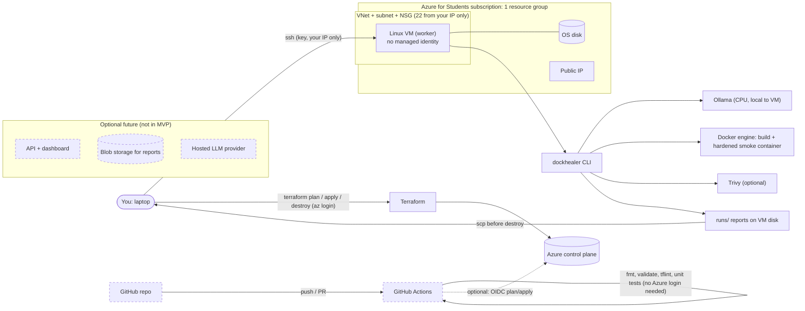

# DockHealer deployment plan (Terraform + Azure for Students)

Status: **PLAN ONLY.** Nothing in this document has been provisioned, applied or committed. No Terraform files exist yet.
Labels used throughout: **[V]** verified by me in this workspace or on a cited page, **[I]** inferred from code or reasoning,
**[?]** not verified: you must check it on your machine/subscription before relying on it.

---------------------------------------------------------------------------------------------------

## A. Project audit

### What exists (verified in the workspace, 2026-10-24)
| Item | Finding |
|---|---|
| Size | 2,309 lines of Python in `src/dockhealer/` (13 modules) [V] |
| Tests | **183 passing** (not 165; Phases 4 to 7 added more) [V]. All use injected fakes for Docker, Ollama, Trivy and the HTTP probe, so **none** of them proves behaviour on a real daemon, a real model or Azure [I, from reading the test helpers] |
| CLI | `doctor, inspect, validate, generate, build, heal, smoke, scan, eval, ask` [V, `--help`] |
| Packaging | `pyproject.toml`, setuptools, Python >= 3.11, one runtime dependency (`requests`), console script `dockhealer` [V]. Editable install not re-tested in this sandbox (PyPI is blocked here) [?] |
| LLM | Ollama only. `OllamaClient.chat(prompt, system, model)`; host from `DOCKHEALER_OLLAMA_HOST` / `OLLAMA_HOST`, model from `DOCKHEALER_MODEL`, timeout from `DOCKHEALER_TIMEOUT`; connect+read timeouts, typed errors, temperature 0, seed 42 [V]. **No auth header, no API-key support, no 429/backoff handling, no provider abstraction** [V] |
| Docker use | `docker build` (staged context, `--progress=plain`, timeout, capped+redacted log), `docker run` for the smoke test (`--cap-drop ALL`, `no-new-privileges`, 512m/1 cpu/256 pids, port on 127.0.0.1, no mounts, always removed), `docker rmi`. All list-form subprocess calls, no shell [V] |
| Trivy | Optional, `--scanners vuln`, skipped cleanly if absent [V] |
| Reports | `runs/<timestamp>-<app>/report.json` + one Dockerfile per attempt; eval writes `runs/eval-*/{results.jsonl,meta.json,report.md}` [V]. **No run IDs, no structured (JSON) logging**; progress is `print` [V] |
| CI | `.github/workflows/ci.yml`: unittest on Python 3.11/3.12. Written but **never executed on GitHub** [V that it exists, ? that it passes there] |
| Terraform/cloud | None. `.gitignore` already excludes state, `.tfvars`, keys [V] |
| Git | **This workspace is not a Git repository** (`git status` fails) [V]. See blockers |
| Tools here | Docker CLI 29.8.2 (no usable daemon); `terraform`, `az`, `trivy`, `ollama`, `tflint` **not installed** [V]. So I cannot run `terraform validate` here; CI and your machine must |

### Discrepancies with your brief
1. Your brief describes the Phase 7 evaluation as validation-first with `EvaluationReport` / `write_report()` and an offline mode. **The code in this workspace is different:** `evaluate.py` is scenario-based (`run_eval`, `aggregate`, `write_results`), exposed as `dockhealer eval`, and it needs real Docker + Ollama to produce results. Its tests check that the corpus validates as claimed, but there is no "validation-only" run mode. If you have another copy of the repo that matches your brief, tell me which is authoritative before Milestone 1.
2. Test count is 183, not 165.
3. Your earlier real runs (HTTP 200 after one repair; 128 HIGH/CRITICAL Trivy findings on one image; a `NO_PROGRESS` stop) happened on your machine; I cannot see those outputs, so I treat them as your reports [?].

### Deployment blockers
| # | Blocker | Fix | Size |
|---|---|---|---|
| 1 | Not a Git repo here; CI/CD and "deploy from repo" need GitHub | `git init`, first commit, push to a **public or private** GitHub repo you own | 15 min |
| 2 | No deployable artifact | Build a wheel (`python -m build`) in CI, or `pip install git+https://...` on the worker | 1 h |
| 3 | No provider abstraction (Ollama only) | Not a blocker for MVP (Ollama on the VM). Needed only for a hosted LLM | see Part C/6 |
| 4 | No run IDs / structured logs | Add `run_id` + JSON-lines event log (Milestone 3) | 3 h |
| 5 | Smoke container and builds have unrestricted outbound network and can reach the cloud metadata endpoint | Mitigated in MVP by giving the VM **no managed identity** and by an iptables rule (Milestone 3) | 2 h |

### Security controls that exist vs. missing
Exist [V]: secret filename exclusion + pattern redaction before prompts and in logs; symlinks not followed; file/size caps; logs fenced as untrusted data for the model; the model can only edit the Dockerfile; no model-run host commands; validator gate; bounded model/retry budgets; build and smoke timeouts; hardened smoke container; cleanup in `finally`.
Missing [V]: authentication of any kind (there is no server, so n/a today); network isolation of builds/containers; per-run disk/CPU quotas on `docker build` itself (build RUN steps can use the whole VM); seccomp/gVisor-class isolation; audit trail; image/artifact retention policy; LLM-key handling; rate limiting. None of the existing controls makes DockHealer safe for untrusted public input; they reduce accidents and limit blast radius for a single trusted user.

---------------------------------------------------------------------------------------------------

## B. Architecture decision

DockHealer **needs a real Docker daemon** (it builds and runs images). That rules out most "managed container" hosting.

| Option | Speed to working | Security | Cost | Ops burden | Interview value | Verdict |
|---|---|---|---|---|---|---|
| **1. One Linux VM worker running the CLI (Docker + Trivy + Ollama), Terraform-managed, SSH-only, ephemeral** | Fastest (days) | Good for single-user: no public service, no cloud identity on the box, NSG limited to your IP | Pay only while it exists | Low | High: IaC, network design, cloud-init, CI, cost control | **Chosen for Milestones 1 to 3** |
| 2. VM worker + small API/dashboard (Container Apps or App Service) that enqueues jobs | Slow (needs API, auth, queue/storage, job isolation) | Hard: untrusted input reaches a machine that runs arbitrary code | Higher (always-on API) | Medium-high | High, but easy to do badly | Defer (Milestone 4, only after 1 to 3) |
| 3. Azure Container Apps / ACI running DockHealer with Docker-in-Docker or privileged mode | Looks quick | **Poor**: needs privileged containers or exposed docker socket; brief forbids it | Medium | High | Negative if explained badly | Rejected |
| 4. AKS | Slow | Complex | High for a student budget | Very high | Decorative: no requirement justifies it | Rejected |
| 5. ACR Tasks (`az acr build`) as the build engine | Medium | Good isolation | Pay per build | Medium | Interesting | Rejected for now: would replace `builder.py`, and the smoke test still needs a runtime |

**Recommendation: Option 1, CLI-only, ephemeral VM.** Reasons: it is the shortest path to a *real* end-to-end run on Azure; it preserves the CLI as the product; it avoids ever exposing a build endpoint; teardown is one `terraform destroy`; and every piece (VNet, NSG, VM, cloud-init, state, CI/OIDC) is something interviewers ask about.

LLM backend for the first deployment: **Ollama on the same VM, CPU-only, `qwen2.5-coder:3b`** (no external account, no external cost, no key to leak). Hosted-LLM support is a later, small code change (Part C/6).

---------------------------------------------------------------------------------------------------

## C. Architecture diagram



---------------------------------------------------------------------------------------------------

## D. Terraform design (design only: nothing generated yet)

### Authentication
* Local: `az login` (Azure CLI session); the `azurerm` provider uses it. No credentials in files.
* CI (optional, Milestone 2b): GitHub Actions **OIDC / workload identity federation** (`use_oidc = true`), no client secret. HashiCorp documents OIDC as the recommended method for the azurerm backend [V, [azurerm backend docs](https://developer.hashicorp.com/terraform/language/backend/azurerm)].
* **Risk [?]:** an Azure for Students subscription usually sits in your *university's* Entra tenant. Creating an app registration / federated credential and role assignments may be blocked by the tenant admin. Check early: `az ad app create --display-name test-oidc` (and delete it). If denied, CI stays **validate-only** (no Azure login) and applies are run from your laptop. That is still a legitimate, honest pipeline.

### State strategy
| | Local state (recommended first) | Remote state in Azure Storage |
|---|---|---|
| Extra resources | none | storage account + container (small ongoing cost) bootstrapped outside Terraform |
| Fits | one operator, ephemeral environment | CI applies, several people, long-lived infra |
| Risks | file loss; state contains sensitive values in plain text, so it must never be committed (already in `.gitignore`) | misconfigured access = secrets exposure; needs `use_azuread_auth` and a least-privilege role (Storage Blob Data Contributor on the container) [V, azurerm backend docs] |
**Recommendation:** local state for Milestone 1 (the VM is ephemeral and I will keep no secrets in Terraform). Migrate with `terraform init -migrate-state` only if you enable CI apply.

### Directory tree (to be created in Milestone 1)
```
infra/azure/worker/
  versions.tf             required_version ">= 1.9, < 2.0"; azurerm "~> 4.0" (pin exact minor after first init)
  providers.tf            provider "azurerm" { features {} ; subscription_id = var.subscription_id }
  variables.tf            subscription_id, location, vm_size, admin_username, ssh_public_key_path,
                          allowed_ssh_cidr (no default; must be your /32), name_prefix, tags
  main.tf                 resource group, vnet, subnet, NSG + rule, public IP, NIC, VM, auto-shutdown
  cloud-init.yaml         minimal: docker, python3-venv, create user, unattended-upgrades
  outputs.tf              public_ip, ssh_command, resource_group_name
  terraform.tfvars.example  placeholders only (real .tfvars is git-ignored)
  README.md               plan/apply/destroy runbook
deploy/bootstrap.sh       runs ON the VM over ssh: install pinned Ollama + Trivy + dockhealer wheel, pull model
.github/workflows/terraform.yml   fmt, validate, tflint (+ optional OIDC plan)
```

### Resource inventory (minimum viable set)
| Resource | Why | Cost note |
|---|---|---|
| `azurerm_resource_group` | single deletion boundary; tag target | free |
| `azurerm_virtual_network` + `azurerm_subnet` | isolates the worker | free |
| `azurerm_network_security_group` (+association) | only inbound: TCP 22 from `allowed_ssh_cidr` | free |
| `azurerm_public_ip` (Standard, static) | reach the VM over SSH | **billed** while it exists [?] |
| `azurerm_network_interface` | VM networking | free |
| `azurerm_linux_virtual_machine` | Docker host, Ollama, Trivy, DockHealer. SSH key auth only, password auth disabled, **no managed identity**, Ubuntu 24.04 LTS image | compute billed per hour while allocated; OS disk billed until deleted |
| `azurerm_dev_test_global_vm_shutdown_schedule` | auto-shutdown safety net so a forgotten VM stops | free; stopping from the OS is not enough: use deallocate |
| Budget alert (`azurerm_consumption_budget_resource_group`) | email alert at 50/80% | **[?]** may be unavailable on Students offers; fallback is a manual alert in Cost Management |
Deliberately **not** created: ACR, Key Vault, Storage, Log Analytics, Bastion, load balancer, Container Apps, AKS. Each adds cost and surface area without a requirement.

### What Terraform does vs. what configures the app
* Terraform: everything in the table above.
* cloud-init (once, at first boot): Docker engine, base packages, user, auto-updates. Kept small and idempotent.
* `deploy/bootstrap.sh` (you run via ssh, or CI later): pinned downloads with checksum verification for Ollama and Trivy (no unreviewed `curl | sh`), `pip install` of the DockHealer wheel, `ollama pull qwen2.5-coder:3b`. Keeping this out of Terraform means app changes never force VM replacement.

### Variables and outputs
Variables above; **no secret variables in MVP**. Outputs: `public_ip`, `ssh_command`, `resource_group_name`.

### Workflow
```
az login
az account show                                   # confirm it is the Students subscription
az vm list-skus -l <region> --size Standard_B --resource-type virtualMachines -o table   # see what you may deploy [?]
cd infra/azure/worker && cp terraform.tfvars.example terraform.tfvars   # edit: subscription_id, region, your /32
terraform init && terraform fmt -check && terraform validate
terraform plan -out tfplan                        # READ IT; I will walk through it with you
# ---- explicit approval point: nothing below runs without you saying "apply" ----
terraform apply tfplan
ssh <user>@<ip> 'bash -s' < ../../../deploy/bootstrap.sh
# ... run the demo ...
scp -r <user>@<ip>:~/dockhealer/runs ./evidence/
terraform destroy                                 # type yes only after confirming the resource list
az resource list --resource-group <rg> -o table   # must be empty / group gone
```
Drift: `terraform plan` should show no changes between apply and destroy; if it does, someone changed the VM by hand. Lifecycle: ephemeral by design, so no `prevent_destroy` on anything holding data; evidence is copied out before destroy.

### Azure for Students facts that shape this (cited)
* $100 credit for 12 months; charges are deducted from credit; **when credit is exhausted or 12 months pass, the subscription is canceled/disabled** [V, [Azure for Students program](https://learn.microsoft.com/en-us/azure/education-hub/azure-dev-tools-teaching/azure-students-program), [disabled-subscription page](https://learn.microsoft.com/en-us/azure/cost-management-billing/manage/azurestudents-subscription-disabled)]. That page does not say what happens to resources/data, so treat running out of credit as data loss risk and copy evidence out.
* Terms say usage is for education, non-commercial research, or building/testing/demonstrating software for those purposes [V, same page]. A portfolio demo fits; **running a public service for third parties is a grey area** [?].
* Region/SKU/quota restrictions are per-student and **not publicly documented**; Microsoft staff say policy, quota, SKU and live capacity are evaluated separately [V, [Microsoft Tech Community thread, informal](https://techcommunity.microsoft.com/discussions/microsoft-learn-for-educators/sku-quota-and-policy-restrictions-on-azure-for-students-and-free-subscriptions/4525160/replies/4526776)]. Users there report allowed-region lists that do not include East US, unavailable older sizes (B1s), zone selection blocking VM creation, and regional vCPU quota limits (stay under ~4 cores). That is community evidence, not an official list. **So: region and VM size are Terraform variables with no hard-coded default assumption, and zones are not requested.**

---------------------------------------------------------------------------------------------------

## E. Security assessment

### Single-user private MVP (what we do)
| Risk | Status today | MVP control |
|---|---|---|
| Malicious/buggy Dockerfile or build script executes code on the host | Exists by design (`RUN` steps) | Dedicated throw-away VM, no managed identity, no cloud credentials, no secrets on disk, destroy after use |
| Cloud metadata endpoint reachable from build/containers | Open | No identity assigned, so nothing to steal; add `iptables -I DOCKER-USER -d 169.254.169.254 -j DROP` in bootstrap (M3) |
| Docker socket / daemon exposure | Not exposed (CLI uses local socket) | Daemon never bound to TCP; only SSH inbound |
| Public attack surface | None in code | NSG: 22 from your /32 only; key auth; password auth off |
| Container escape from smoke test | Mitigated, not eliminated (shared kernel) | Existing flags + disposable VM. Say this plainly in README |
| Prompt injection from repo files/logs | Partly mitigated (fenced untrusted data, model only edits Dockerfile, output revalidated) | Keep; not a guarantee |
| Secrets into prompts/logs | Partly mitigated (filename exclusion + regex redaction) | Do not scan real secrets; `.env.example` style only. Redaction is pattern-based and can miss things |
| Resource exhaustion | Build/smoke timeouts and caps exist; `docker build` CPU/disk unbounded | Auto-shutdown, VM size is the cap; `docker system prune` between runs |
| Vulnerable base images | Trivy shows known CVEs only | Informational; never "secure" |
| Supply chain (Ollama/Trivy/pip) | Not handled | Pin versions, verify checksums, run CI with `pip` pinned; consider `pip-audit` later |

### Before accepting untrusted public submissions (not in scope for MVP)
Authentication and per-user authorization; separate API host from a **per-job disposable worker** (one fresh microVM or VM per build, no shared disk); egress filtering; rootless/gVisor/Kata or Firecracker-class isolation; per-user quotas and rate limits; upload validation (zip-slip, symlinks, size); artifact retention and deletion; abuse monitoring; LLM spend caps; legal/terms review of Azure for Students use. Until these exist, **do not expose any endpoint that accepts code.**

---------------------------------------------------------------------------------------------------

## F. CI/CD plan

| Stage | Trigger | Needs Azure login? | What |
|---|---|---|---|
| `test` (exists) | push, PR | no | unittest on 3.11 and 3.12 (plus `pytest -q` to confirm both runners) |
| `package` | push, PR | no | `python -m build`, `pip install dist/*.whl`, `dockhealer --version` |
| `terraform-static` | PR touching `infra/**` | no | `terraform fmt -check`, `terraform init -backend=false`, `terraform validate`, `tflint`; optional `trivy config infra/` |
| `terraform-plan` (optional) | PR | **yes, OIDC** | `terraform plan`, plan posted as PR comment. Needs federated credential + Reader (and Contributor only for apply). Blocked if tenant forbids app registrations [?] |
| `deploy` | manual `workflow_dispatch`, protected `environment` with required reviewer | yes, OIDC | `terraform apply` of a saved plan. **Off by default**; manual approval is the safety gate |
Permissions: workflows default to `contents: read`; only the OIDC jobs add `id-token: write`. No long-lived secrets in the repo; subscription/tenant/client IDs are non-secret variables. Rollback: re-apply the previous commit's Terraform (infra) or re-run bootstrap with the previous wheel (app). Because the worker is disposable, "rollback" is usually destroy + recreate.

---------------------------------------------------------------------------------------------------

## G. Fast implementation roadmap

| Milestone | Objective | Tasks / files | Acceptance criteria | Time | Cost |
|---|---|---|---|---|---|
| **M0 Baseline** | Know the starting point | Push repo to GitHub; run `dockhealer doctor`, full tests, `dockhealer eval --only ...` locally; `az login`; `az vm list-skus` for your allowed regions; check you can create an Entra app (OIDC feasibility) | tests green on your machine and in GitHub Actions; a written list of allowed regions/sizes; OIDC feasible yes/no | 2 to 4 h | 0 |
| **M1 MVP on Azure** | Real end-to-end run on Azure | Create `infra/azure/worker/*`, `deploy/bootstrap.sh`; `plan` (reviewed with me) then **your explicit approval** then `apply`; bootstrap; run `dockhealer heal examples/flask_app --out ... --scan`; capture logs + `report.json`; destroy | healed Dockerfile produced on the VM; smoke 200; evidence copied out; `destroy` leaves empty RG | 1 to 2 days | est. below |
| **M2 CI/CD** | Reproducible checks | `terraform.yml`, package job, README badges; OIDC plan only if feasible | PR shows fmt/validate/tflint green; deploy job exists but needs approval | 0.5 to 1 day | 0 |
| **M3 Reliability** | Observable and safer | `run_id`; JSON-lines event log (outcome, attempts, durations, LLM calls/failures, smoke, scan); report retention script; IMDS block; failure tests (kill Ollama, fill disk, bad model) | log has no secrets (test); failures produce clear errors | 1 to 2 days | ~0 |
| **M4 Interface (optional)** | API/dashboard | Only if time remains; separate API from per-job worker; see Part E | not started until M1 to M3 done | 1 to 2 weeks | recurring |
| **M5 Portfolio finish** | Evidence | Diagram, runbook, cost table with real numbers, eval report from the VM, demo script | a stranger can follow the README | 1 day | 0 |

Must-have: M0, M1, M2 (static checks). Optional: OIDC plan/apply, M3 extras, M4.

---------------------------------------------------------------------------------------------------

## H. Cost plan

Prices are third-party aggregators, **not Azure's own calculator**, and Azure changes prices; confirm in the [Azure pricing calculator](https://azure.microsoft.com/pricing/calculator/) for your region before applying.

| Item | Figure | Source / status |
|---|---|---|
| Standard_B2s_v2 (2 vCPU, 8 GiB), Linux, East US | **$0.0832/hour** (about $60.74/month if left on 730 h) | [azurespeed](https://www.azurespeed.com/AzureVmPricing/Standard_B2s_v2); page gives no date [?] |
| Standard_B2ats_v2 (2 vCPU, **1 GiB**), East US | $0.0094/hour (about $6.86/month); cheapest listed region $0.0062/hour | [cloudprice, dated 2026-10-19](https://cloudprice.net/vm/Standard_B2ats_v2) |
| OS disk, public IP, VNet/NSG | not verified: **look up in the calculator** | [?] |
| Ollama / Trivy / DockHealer | free software | n/a |
| Hosted LLM API (if added later) | **not covered by Azure credit**; billed by the provider | n/a |

* **Size choice:** 1 GiB is too small for Docker builds plus a 3b model (the model alone is roughly 2 GB [I]). Start with an **8 GiB** size (B2s_v2 class) if your subscription permits it; if only smaller sizes are allowed, use the **hosted-LLM path** and keep the VM for Docker only.
* **Per demo:** a 3-hour session on B2s_v2 is about 3 x $0.0832 = **$0.25 compute** (plus disk/IP for the same period). A full day on is about $2. Leaving it on for a month is about $61, **over half of your $100 credit**, which is why the design is destroy-after-use.
* **Controls:** destroy after each session; auto-shutdown schedule; Cost Management budget alert (an alert is a notification, **not a spending cap**, and deallocation still leaves disk and static-IP charges); tags (`project=dockhealer`, `env=dev`, `owner`); `az resource list` after destroy; check balance at the [Sponsorships portal](https://www.microsoftazuresponsorships.com/balance).

---------------------------------------------------------------------------------------------------

## I. Interview and portfolio value

Skills this demonstrates: Terraform (providers, variables, state, plan/apply/destroy, drift), Azure networking and least-privilege access, cloud-init and idempotent bootstrap, supply-chain hygiene (pins, checksums, Trivy), GitHub Actions with OIDC (or a justified fallback), threat modelling of a system that executes untrusted code, cost governance, and honest evaluation of an LLM system.
Evidence to collect (all real, none invented): `terraform plan` output; `az resource list` before/after destroy; `report.json` and attempt Dockerfiles from the VM run; smoke result; Trivy summary (with the "known CVEs only" caveat); `dockhealer eval` report with n and intervals; green CI run URLs; the cost line from Cost Management after the demo; a short threat-model table (Part E).

---------------------------------------------------------------------------------------------------

## J. Smaller code change for a hosted LLM (later, optional)

`healer`, `generator` and `repair` only call `client.chat(prompt, system=..., model=...)` and read `.content/.model/.duration_s/.output_tokens`. So: add `OpenAICompatClient` with that same interface in `llm.py`, select it with `DOCKHEALER_PROVIDER=ollama|openai` (default `ollama`, so local use is unchanged), read the key from `DOCKHEALER_API_KEY` at runtime (never a file or Terraform variable), and add bounded retry with backoff for 429/5xx under the existing attempt budgets. Tests use a fake HTTP session as in `test_llm.py`.

---------------------------------------------------------------------------------------------------

## K. Single best next action

**M0, step 1: put the project in a GitHub repository and get the existing CI green there.** Nothing else (OIDC, Terraform CI, bootstrap-from-repo) works without it.
```
cd <your dockhealer folder>
git init -b main && git add -A && git status        # confirm no .env/.tfvars/keys are staged
git commit -m "DockHealer phases 1-7"
gh repo create dockhealer --private --source . --push
gh run watch                                         # the ci workflow should pass on 3.11 and 3.12
```
Then run these two read-only checks and paste the output (they create nothing and cost nothing):
```
az login && az account show --query "{name:name, state:state}" -o table
az vm list-skus --location <a region you can pick> --size Standard_B --resource-type virtualMachines -o table
```
**Approval gates:** I will not write the Terraform files until you approve this plan, and I will never run `terraform apply`, create Azure resources, or delete anything without your explicit "apply" after you have seen the plan output.
