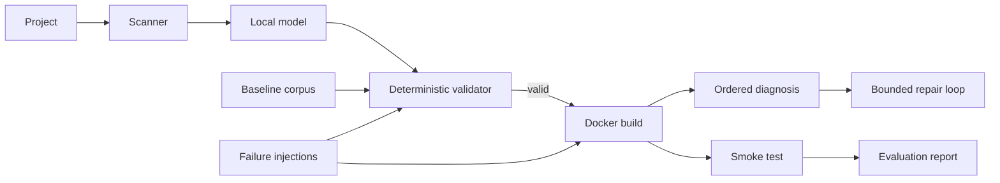

# Phase 7: failure injection and evaluation

## What we are measuring

The three reference Dockerfiles in `baselines/` are expected to validate cleanly. The five
Dockerfiles in `failures/` deliberately contain a known defect. In the default offline experiment,
the validator must reject every injected failure. With `--build`, valid injected failures are sent
through Docker and the existing ordered diagnosis rules classify the real log.

This is a regression test, not proof that Dockhealer can repair every Dockerfile:

| Result | Meaning |
|---|---|
| baseline validates | no false positive on a known-good recipe |
| failure rejected | cheap deterministic gate caught it |
| failure build fails | Docker exposed a problem and diagnosis classified it |
| failure builds | corpus regression: the injection no longer represents a failure |

Run:

```bash
dockhealer evaluate --report runs/evaluation.json
dockhealer evaluate --build --report runs/evaluation.json
```

The JSON report is the durable artifact. It records the exact case, validation findings, whether a
build was attempted, and the diagnosis category. Do not compare raw build time or vulnerability
counts between machines without recording Docker version, base-image digest, network state, and scan
database date.

## Architecture



## Exercises

1. Why should a validator-rejected failure not be counted as a successful Docker build?
2. If all five injections are caught, what classes of bugs are still absent from this experiment?
3. Why can a Trivy count change between two identical evaluation runs?

## Limits

The corpus is intentionally tiny and hand-written. It does not measure model quality, repair
success rate, application correctness, or production security. Those require repeated runs over a
larger corpus and a separately reviewed success criterion.
